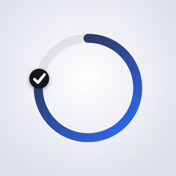
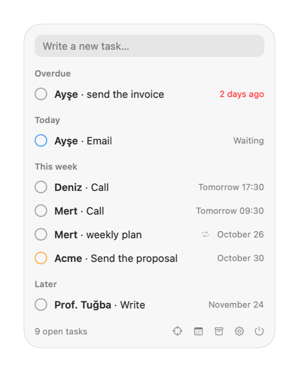
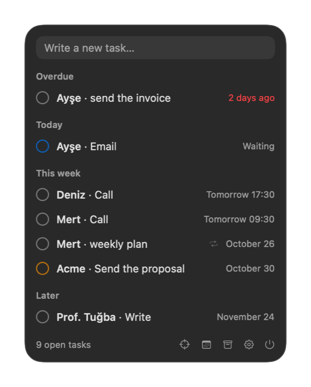
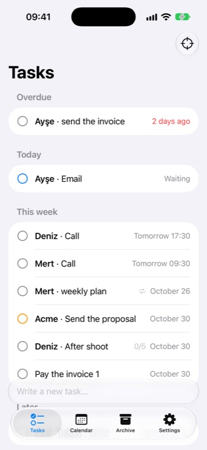
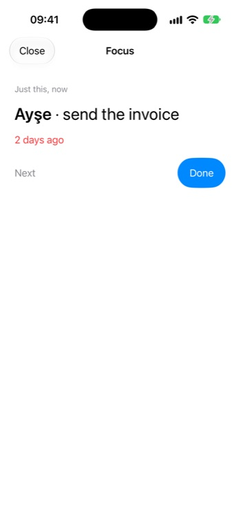
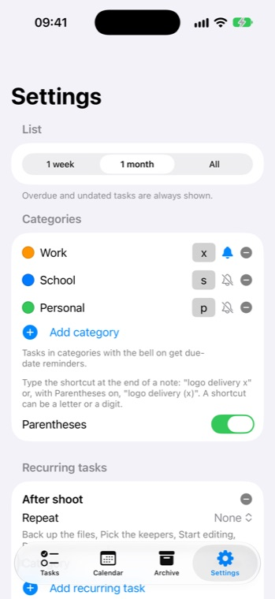
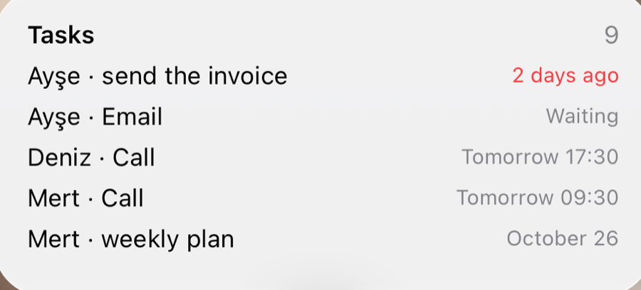

<p align="center"></p>

# ishler

A small task app for your menu bar and your iPhone. Type a sentence, and it works out the person, the task and the date, then reminds you when it's time. Free and open source, available in Turkish and English.

> "Cuma'ya kadar Acme müşterisine teklif at x" → person: Acme · task: teklif at · due: Friday · category: Work

It started as a fix for tasks that get lost between notes, calendars and ten different lists. Everything stays on your devices and syncs through your own iCloud.

<p align="center">
  
  
</p>
<p align="center">
  
  
  
</p>
<p align="center"></p>

## What it does

- **One sentence, no forms.** Dates ("tomorrow", "Friday", "24 November", "in 3 days"), times ("17:30", "5pm"), repeats ("every Monday", "her ayın 15'i") and people are understood in Turkish and English, entirely on-device. No server and no AI service.
- **Categories with shortcuts.** End a note with `x` or `(x)` to file it under a category. Each category has its own colour and its own optional reminders.
- **Recurring tasks** that put themselves back on your list (a monthly invoice on the 15th, a weekly plan), with checklists.
- **Calm reminders.** The evenings before a deadline, the morning of, and a nudge only after you've been away for a while. Done and snooze buttons sit right on the notification.
- **Apple integrations.** Apple Calendar, widgets, a focus screen ("just this, now"), Siri and Shortcuts, Spotlight, CSV export.
- **Menu bar or Dock.** Use it only from the menu bar, as a regular Dock app, or both. ⌃⌥N opens quick add from anywhere.
- **Syncs through your own iCloud.** There is no server in between.

## Install (Mac)

Download the latest `.dmg` from [Releases](../../releases), open it and drag **ishler** to Applications. The app is signed and notarized by Apple.

## Build from source

Requires Xcode 27 and [XcodeGen](https://github.com/yonaskolb/XcodeGen).

```sh
brew install xcodegen
xcodegen generate
open MenuBarTodo.xcodeproj
```

The parsing, scheduling and storage logic lives in the `TodoCore` Swift package and has its own tests:

```sh
cd TodoCore && swift test
```

To run your own build, change the team, bundle identifiers, App Group and iCloud container in `project.yml` to your own.

## Website

The landing page lives in [`site/`](site/) (plain HTML, no build step).

## License

MIT
